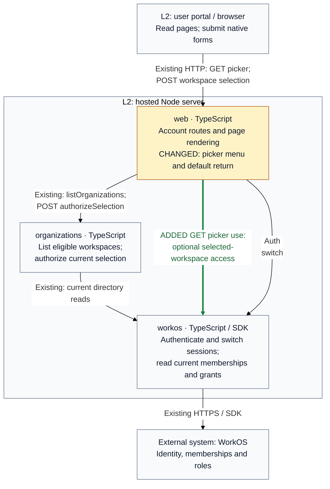

## Architecture comparison — draft, implementation pending

**T2 Need architect** is anticipated because the picker adds an optional runtime
use of the existing supplied AccessResolver (`internalInterface=true`). Base:
`77477864d8238b9141e9619b6bcbb6b0aa7fb11b`; final head pending.

Supplementary C4 Level 3 comparison: the hosted Node server keeps the same owners.
Arrows show runtime calls through supplied contracts. Amber marks changed web
behavior; green marks the added picker GET use. Neutral calls remain.

- **Return:** bare picker forms now return to Connect at the normalized public
  base path. Explicit validated destinations keep their existing behavior.
- **Display:** the picker gains one compact native menu. Only current allowed
  grants for the selected workspace can show Members and Audit Log.
- **Recovery:** an optional role lookup denial or outage hides privileged links
  while the picker remains usable. Cancellation propagates; list failures retain
  the existing safe failure page and cookie effects.
- **Authority:** selection POST still checks Origin, CSRF, return path and current
  eligible membership before one session switch. Cookie order, refusal outcomes,
  other browser sessions and MCP-token workspace bindings remain unchanged.

The neutral Auth/switch arrow condenses session authentication and the POST-only
switch. App composition, identity-owned contracts, unrelated account routes and
MCP are omitted. The existing external API and HTTPS edge remain; its new caller
context is on the green arrow. No production callable contract changes, so L4 is
omitted. Registry block changes and final revision pins await implementation review.
